# Notebooks summary

| File | Content |
|---|---|
| `part_1_notebook.py` | Activity classification from phone accelerometer data (Phyphox) |
| `part_2_notebook.py` | Stress detection from physiological signals (WESAD) |
| `part_3_notebook.py` | Sleep staging with the SleepFM foundation model (HMC) |
| `sleepfm_models.py` | SleepFM model classes, imported by part 3 |
| `AML_phyphox_PW2627.ipynb` | Blank instructor template of part 1 |
| `AML_StressDetection_PW2627.ipynb` | Blank instructor template of part 2 |

The `.py` files are marimo notebooks: they are the completed versions of the two `.ipynb` templates (plus part 3).
All figures and numbers below come from the last saved run of each notebook (`__marimo__/session/`). The figures are in `summary_assets/`.

## Table of contents

- [Train / validation / test at a glance](#train--validation--test-at-a-glance)
- [Part 1: Activity classification (Phyphox)](#part-1-activity-classification-phyphox)
  - [1. Data](#1-data)
  - [2. Windowing](#2-windowing)
  - [3. Selected features](#3-selected-features)
  - [4. Dimensionality reduction](#4-dimensionality-reduction)
  - [5. Train / validation / test](#5-train--validation--test-yes-there-is-a-real-test-set)
  - [6. Model comparison](#6-model-comparison)
  - [7. Results of the best model](#7-results-of-the-best-model)
  - [8. Limitations of the protocol](#8-limitations-of-the-protocol)
- [Part 2: Stress detection (WESAD)](#part-2-stress-detection-wesad)
  - [1. Data and exploration](#1-data-and-exploration)
  - [2. Preprocessing](#2-preprocessing-given-by-the-template)
  - [3. Validation: LOSO, and no separate test set](#3-validation-leave-one-subject-out-loso-and-no-separate-test-set)
  - [4. Models and tuning](#4-models-and-tuning)
  - [5. Evaluation](#5-evaluation)
  - [6. Interpretation: permutation importance](#6-interpretation-permutation-importance)
- [Part 3: Sleep staging with SleepFM (HMC)](#part-3-sleep-staging-with-sleepfm-hmc)
  - [1. Data](#1-data-1)
  - [Train / validation / test](#train--validation--test-yes-there-is-a-real-test-set)
  - [2. Embeddings with the base model](#2-embeddings-with-the-base-model)
  - [3. Staging head](#3-staging-head-sleepfm_modelspy)
  - [4. Results](#4-results)
  - [Why macro-F1 and not micro or weighted F1?](#why-macro-f1-and-not-micro-or-weighted-f1)
  - [5. Training history](#5-training-history)
  - [6. Kappa per night](#6-kappa-per-night)
- [Things to fix before handing in](#things-to-fix-before-handing-in)

### Train / validation / test at a glance

| Notebook | Training data | Validation (used for choices) | Separate test set? | Is the reported score unbiased? |
|---|---|---|---|---|
| Part 1 | 134 windows (first 80% of each recording) | `GroupKFold`, 5 time blocks per activity (fold *k* = block *k* of every activity), inside the training set | **Yes**: last 20% of each recording (35 windows) | **Yes**, but small and from the same recordings |
| Part 2 | 14 subjects in each LOSO fold | The held-out subject of each LOSO fold | **No**: the LOSO folds serve as both validation and test | **Slightly optimistic** (tuned and reported on the same folds) |
| Part 3 | 11 HMC nights (heads trained by the instructor) | 5 other HMC nights (learning rate + best epoch) | **Yes**: 5 nights never used for training or selection | **Yes**, but only 5 nights from one hospital |

---

## Part 1: Activity classification (Phyphox)

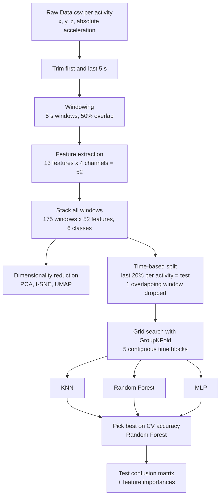

### 1. Data
Six activities, each recorded with Phyphox: **hammer, violin, running, elevator, side_steps, subway**.
Each recording has 4 channels: linear acceleration x, y, z and absolute acceleration (the norm of the three axes).

| Raw signals of one activity (subway) | One channel (x) for all activities |
|---|---|
| 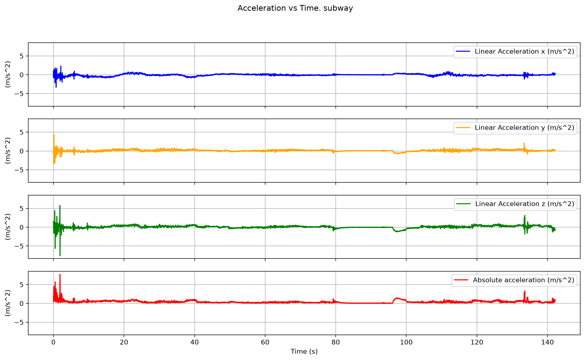 | 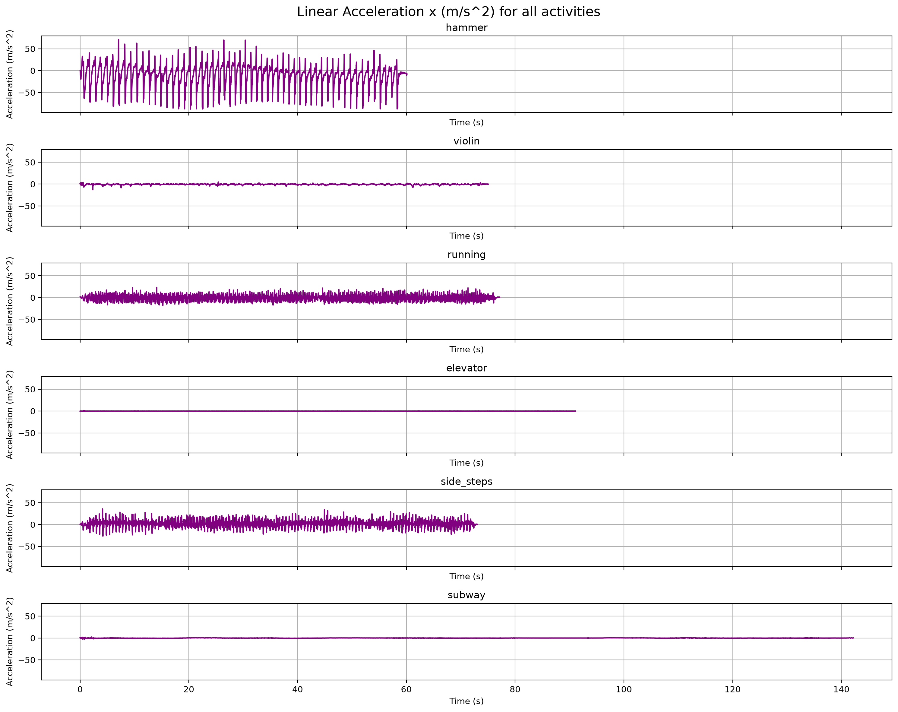 |

The first and last 5 s of every recording are removed (time to start the recording and put the phone away).

### 2. Windowing
- **Window length: 5 s, overlap: 50%** (a new window every 2.5 s).
- 5 s was chosen so that one window covers a full cycle of the slowest activities (a hammer stroke, a violin bow movement, a subway start or stop).
- Number of windows per activity: hammer 19, violin 25, running 25, elevator 31, side_steps 24, subway 51, so **175 windows in total**.

### 3. Selected features
13 features are computed on **each of the 4 channels**, so each window becomes a vector of **52 values** (`extract_window_features`).

| Domain | Feature | What it captures |
|---|---|---|
| Time | mean | Average acceleration (offset, orientation) |
| Time | std | How much the signal moves |
| Time | min, max | Extreme values |
| Time | skewness | Asymmetry of the distribution (long tail of high values) |
| Time | kurtosis | Rare large spikes vs smooth signal |
| Time | peak-to-peak | Full range (max − min): how violent the strongest movement is |
| Frequency | dominant frequency | Main rhythm of the movement (highest peak of the Welch spectrum, 0 Hz ignored) |
| Frequency | spectral centroid | "Centre of mass" of the spectrum: slow vs fast movements |
| Frequency | spectral entropy | Power concentrated in a few peaks (rhythmic) vs spread (noise-like) |
| Frequency | power 0.5–3 Hz | Slow movements (walking pace, vehicle acceleration) |
| Frequency | power 3–8 Hz | Medium-speed movements |
| Frequency | power 8–15 Hz | Fast vibrations and impacts |

The notebook illustrates each feature on the two activities with its lowest and highest value:

| Skewness | Kurtosis | Peak to peak |
|---|---|---|
| 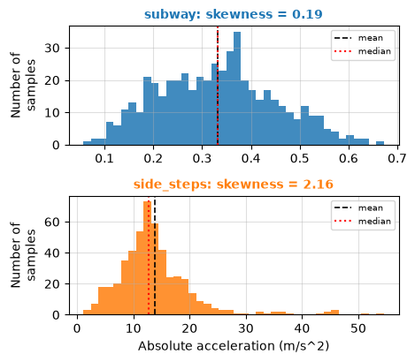 | 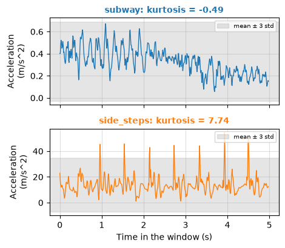 | 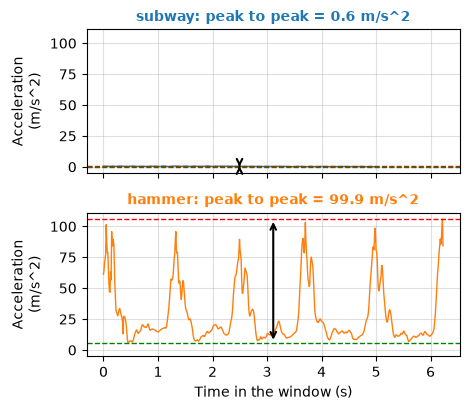 |

| Dominant frequency | Spectral centroid | Spectral entropy |
|---|---|---|
| 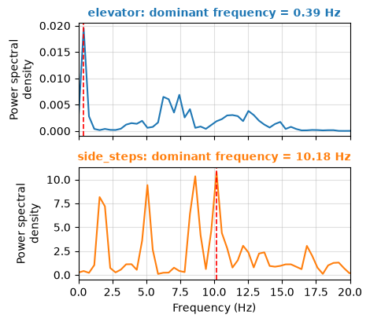 | 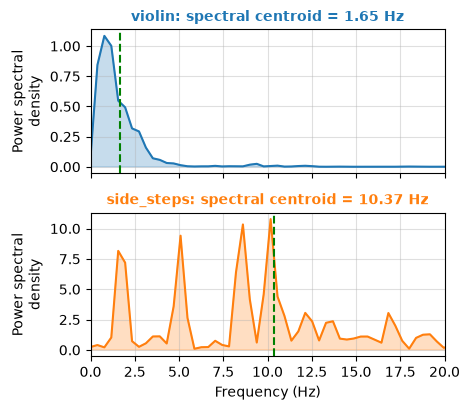 | 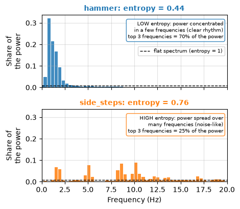 |

| Power 0.5–3 Hz | Power 3–8 Hz | Power 8–15 Hz |
|---|---|---|
| 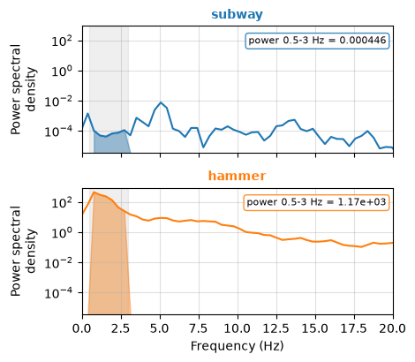 | 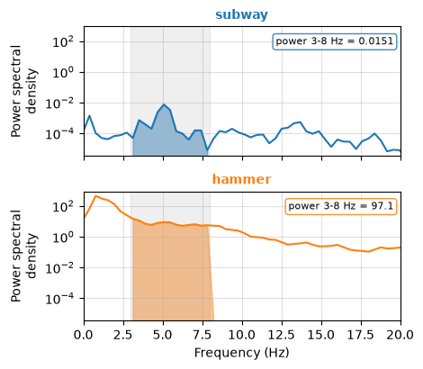 | 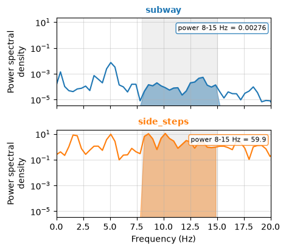 |

**Hypothesis before training:** the dominant frequency would be the most discriminative feature.

### 4. Dimensionality reduction
The features are standardised (`StandardScaler`) before the projections.

| PCA | t-SNE (perplexity 10) | UMAP |
|---|---|---|
| 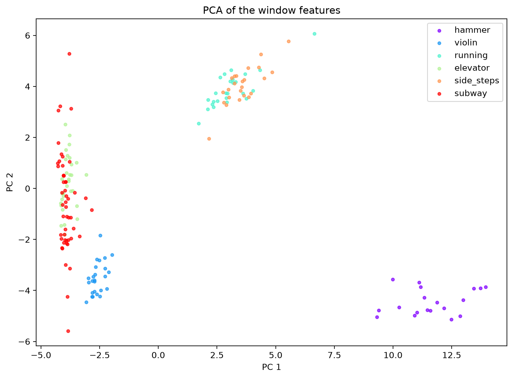 | 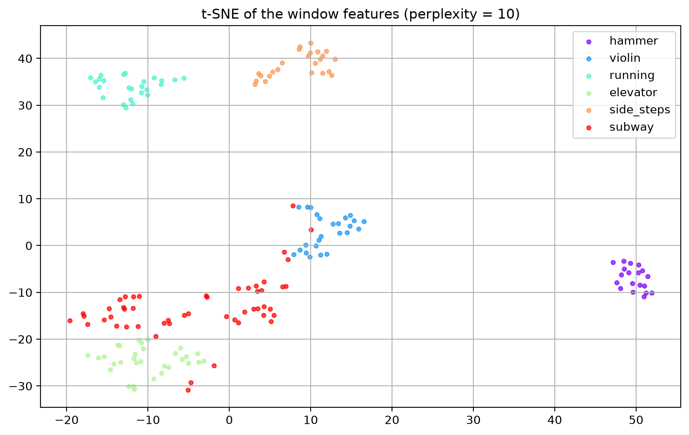 | 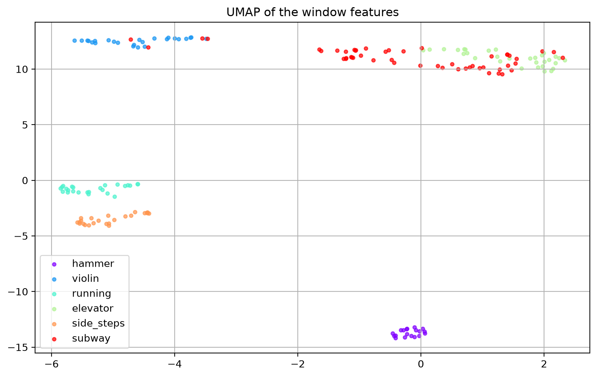 |

- **PCA:** the first 2 components keep **69.7%** of the variance, and 14 components are needed for 95%. Being linear, it mixes elevator with subway and side steps with running.
- **t-SNE:** gives the best separation. Elevator and subway are still close, but form two distinct groups (subway around elevator). A few subway windows sit near violin: they are the start/stop accelerations of the train.
- **UMAP:** separates all classes well except elevator and subway, which overlap.
- Elevator and subway are hard because in both "nothing happens" most of the time, apart from accelerations at start and stop.

### 5. Train / validation / test: yes, there is a real test set
Consecutive windows overlap by 50%, so a random split would put almost identical windows in train and test (data leakage). The split is therefore done **in time**:

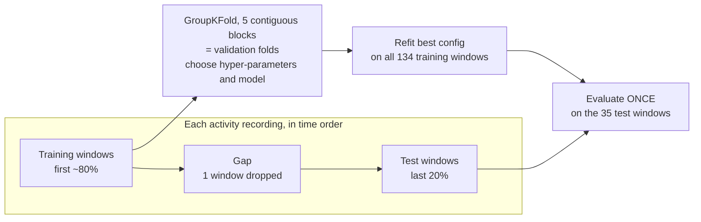

The split is done **separately for each activity**, then the pieces are concatenated. Every window is a 52-value feature vector:

```
One activity, windows in time order:
[ block 0 | block 1 | block 2 | block 3 | block 4 ] [gap] [ test: last 20% ]
└──────────── training set (5 CV blocks) ────────┘ 1 win
```

- **Test set:** for each activity, the **last 20% of the windows in time**, 35 windows in total. Every activity is therefore in the test set, in the same proportion as in the full data.
- **Gap:** the 1 window that overlaps the first test window is removed from training (`gap_windows = 1`), so no test signal appears in the training data.
- **Training set:** everything before the gap, 134 windows in total.
- **Validation:** `GridSearchCV` with **`GroupKFold` (5 folds)** on the 134 training windows only:
  - The training windows of **each activity** are cut into **5 consecutive blocks** with ids 0 to 4 (`cv_groups`).
  - In fold *k*, **block *k* of every activity** is the validation set, and the other 4 blocks of every activity are used for training.
  - So every fold has all 6 activities in both training and validation, and the validation windows are continuous stretches of time, not random windows next to their own training neighbours.
  - The `StandardScaler` of KNN and MLP is inside the pipeline, so in each fold it is fitted on the 4 training blocks only.

**Activities don't have the same number of windows.** The blocks are sized relative to each activity's own length (window `i` of an activity with `n` training windows goes to block `⌊5·i / n⌋`). Each block is therefore about 20% of that activity's training windows. In absolute size, though, a block of subway is much bigger than a block of hammer:

| Activity | Windows | Training | Gap | Test | Training windows per CV block (0 → 4) |
|---|---|---|---|---|---|
| hammer | 19 | 14 | 1 | 4 | 3, 3, 3, 3, 2 |
| violin | 25 | 19 | 1 | 5 | 4, 4, 4, 4, 3 |
| running | 25 | 19 | 1 | 5 | 4, 4, 4, 4, 3 |
| elevator | 31 | 24 | 1 | 6 | 5, 5, 5, 5, 4 |
| side_steps | 24 | 18 | 1 | 5 | 4, 4, 3, 4, 3 |
| subway | 51 | 40 | 1 | 10 | 8, 8, 8, 8, 8 |
| **Total** | **175** | **134** | **6** | **35** | **28, 28, 27, 28, 23** (validation size of each fold) |

- **Consequence:** the class imbalance is the same everywhere. Each fold's training part, each validation fold and the test set all have the same class ratios (subway ≈ 30%, hammer ≈ 10%). The imbalance is not corrected, only kept consistent.
- **Edge case:** an activity with fewer than 5 training windows would miss some block ids, and would be absent from the validation set of some folds. This does not happen here (the smallest is hammer, with 14).
- **Small leak inside CV:** there is no gap between two consecutive CV blocks, so the last window of block *k* overlaps 50% with the first window of block *k+1*. The CV scores are therefore slightly optimistic. The test set is not affected, thanks to the gap.
- **Refit:** `GridSearchCV` (`refit=True` by default) retrains the best configuration on **all 134 training windows**. This retrained model predicts the test set.
- **Model selection:** the best model is chosen on **CV accuracy**, never on the test score. The test scores of all three models are shown, but they are not used for any decision.
- **So the test score is unbiased.** Its limits:
  - **Small:** 35 windows, so one error costs about 3% accuracy. The test scores can't separate the models; CV is the more reliable comparison.
  - **Same recordings:** test windows are the end of the same session (same phone, placement, person). They measure generalisation over time inside a recording, not to a new session or person.
  - Minor: the `StandardScaler` used for PCA, t-SNE and UMAP is fitted on all windows, test included. This only affects the plots: the classifiers have their own scaler inside the pipeline, fitted on training data only.

### 6. Model comparison

| Model | Hyper-parameters searched | Best | CV accuracy (train) | Test accuracy | Test macro-F1 |
|---|---|---|---|---|---|
| KNN (with scaling) | K = 1…30 | K = 3 | 0.902 ± 0.050 | 0.971 | 0.978 |
| **Random Forest** | n_estimators ∈ {50, 100, 200, 400}, max_depth ∈ {None, 5, 10, 20} | 400 trees, no depth limit | **0.985 ± 0.018** | 0.971 | 0.977 |
| MLP (with scaling) | hidden layers ∈ {16, 32, 64, 32-16, 64-32}, alpha ∈ {1e-4, 1e-2, 1e-1}, max_iter ∈ {500, 2000} | (32,), alpha = 1e-4, 500 iter | 0.932 ± 0.062 | 1.000 | 1.000 |

| KNN: CV accuracy vs K | Random Forest: CV accuracy vs n_estimators | MLP: CV accuracy vs hidden layers |
|---|---|---|
| 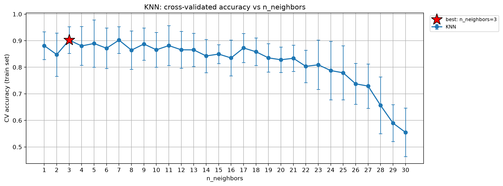 | 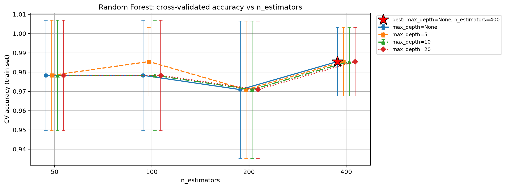 | 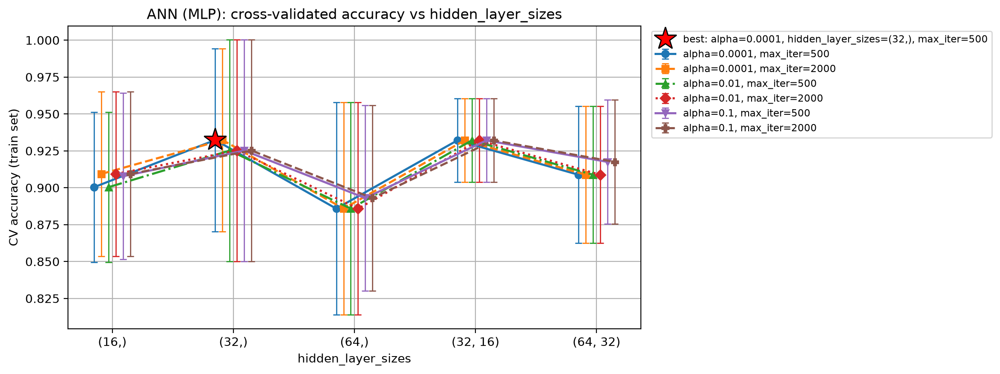 |

**Best model: Random Forest**, chosen on CV accuracy (highest score and lowest variance across folds).
The MLP gets a perfect test score, but its CV score is lower and less stable. With only 35 test windows, one window is about 3% of accuracy, so the difference with the other models on the test set is not meaningful.

| Criterion | KNN | Random Forest | MLP |
|---|---|---|---|
| Accuracy (CV) | 0.90 | **0.98** | 0.93 |
| Robustness (CV std) | ± 0.05 | **± 0.018** | ± 0.06 |
| Interpretability | Easy (nearest examples) | Good (feature importances) | Hard (black box) |
| Cost | Very low to train, stores all data | Medium | Highest (training + tuning) |

### 7. Results of the best model

| Confusion matrix on the test set | Top 20 feature importances |
|---|---|
| 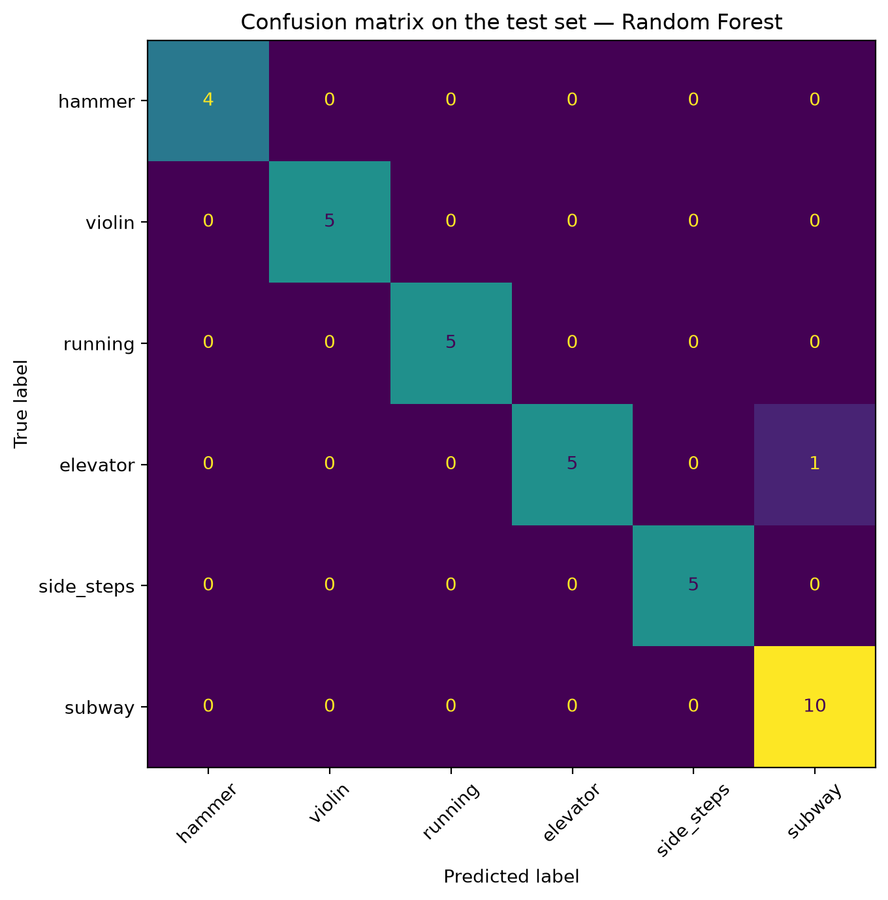 | 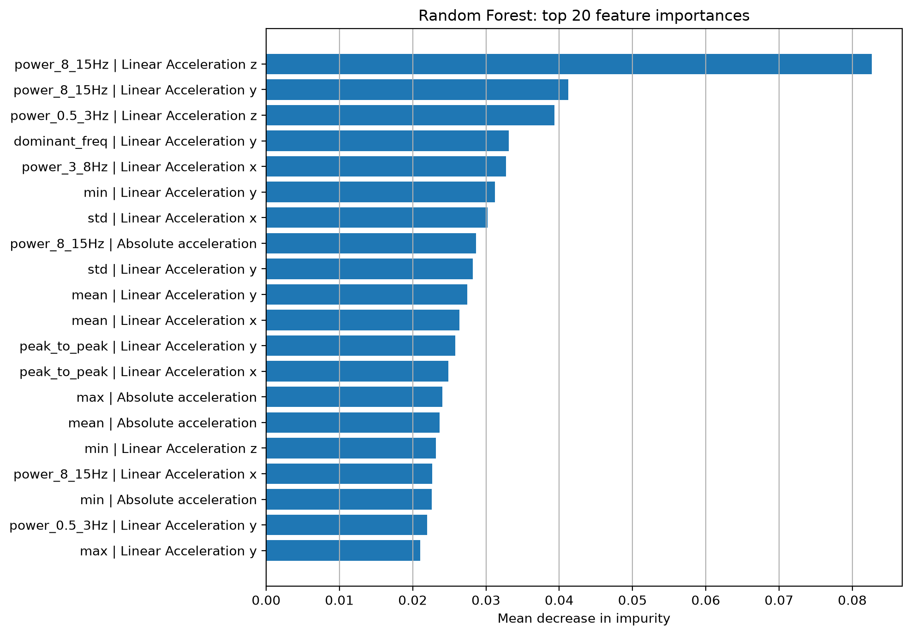 |

- **34 / 35 test windows are correct.** The only error is one **elevator** window predicted as **subway**, the pair that also overlaps in the PCA, t-SNE and UMAP plots.
- Per class: everything has precision and recall 1.00, except elevator (recall 0.83) and subway (precision 0.91).
- **Most important features:** the **band powers**, especially **power 8–15 Hz on z and y** and **power 0.5–3 Hz on z**. The dominant frequency (on y) comes 4th, so the hypothesis was partly right: frequency content matters most, but the band powers describe it better than a single peak.
- A Random Forest is light enough to run on a phone.

### 8. Limitations of the protocol
- The sampling rate depends on the phone model.
- The phone position and orientation must be the same for every recording.
- Recordings contain noise at the start and end (handling the phone).
- Improvements: a clear recording procedure (same placement, same phone, several subjects and sessions), or dedicated sensors.

---

## Part 2: Stress detection (WESAD)

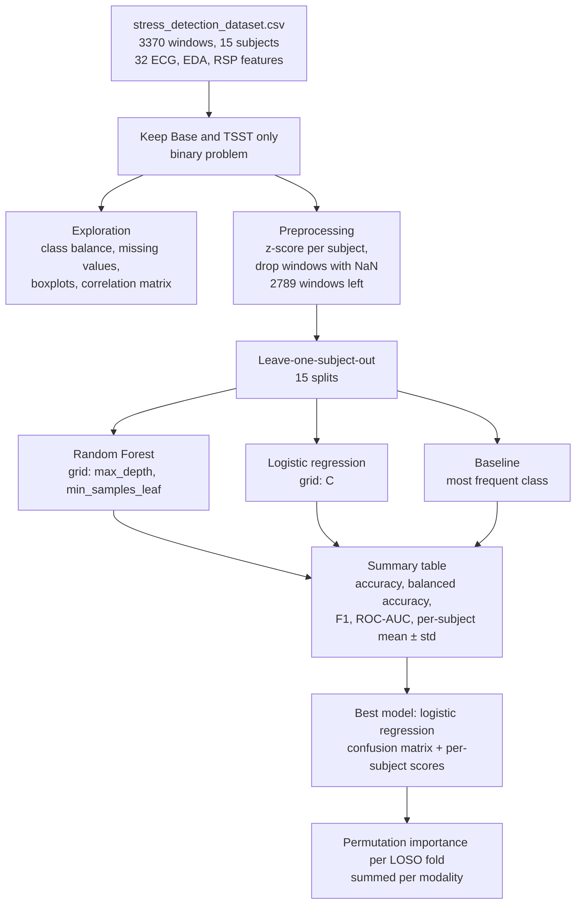

### 1. Data and exploration
Each row is a **60 s window** (a new window every 10 s) of one subject, with **32 features** from three modalities:

| Modality | Features |
|---|---|
| **ECG** (heart) | `ECG_Rate_Mean`, HRV features (`HRV_MeanNN`, `HRV_SDNN`, `HRV_RMSSD`, `HRV_pNN50`, `HRV_TINN`, `HRV_LF`, `HRV_HF`, `HRV_LFHF`, `HRV_LFn`, `HRV_HFn`) |
| **EDA** (skin conductance) | `EDA_*` (mean, std, min, max, range, slope), tonic level `SCL_*`, phasic responses `SCR_*` (count, amplitude, recovery time, area) |
| **RSP** (breathing) | inspiration/expiration duration and ratio, range, RVT, `RSP_Rate_Mean`, `RRV_MeanBB` |

- **Class balance:** 1788 Base (63.5%) vs 1029 TSST (36.5%). The proportion is similar for every subject (TSST between 34% and 40%), so balanced metrics are needed.
- **Missing values:** the 7 RSP features each have 28 missing values, all in **subject S8**. A breathing sensor problem during part of that session is the likely cause.

| ECG: Base vs TSST | EDA: Base vs TSST | RSP: Base vs TSST |
|---|---|---|
| 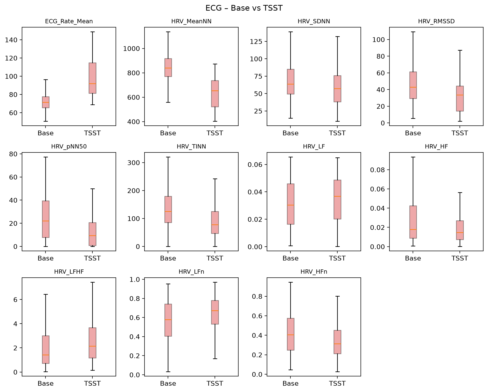 | 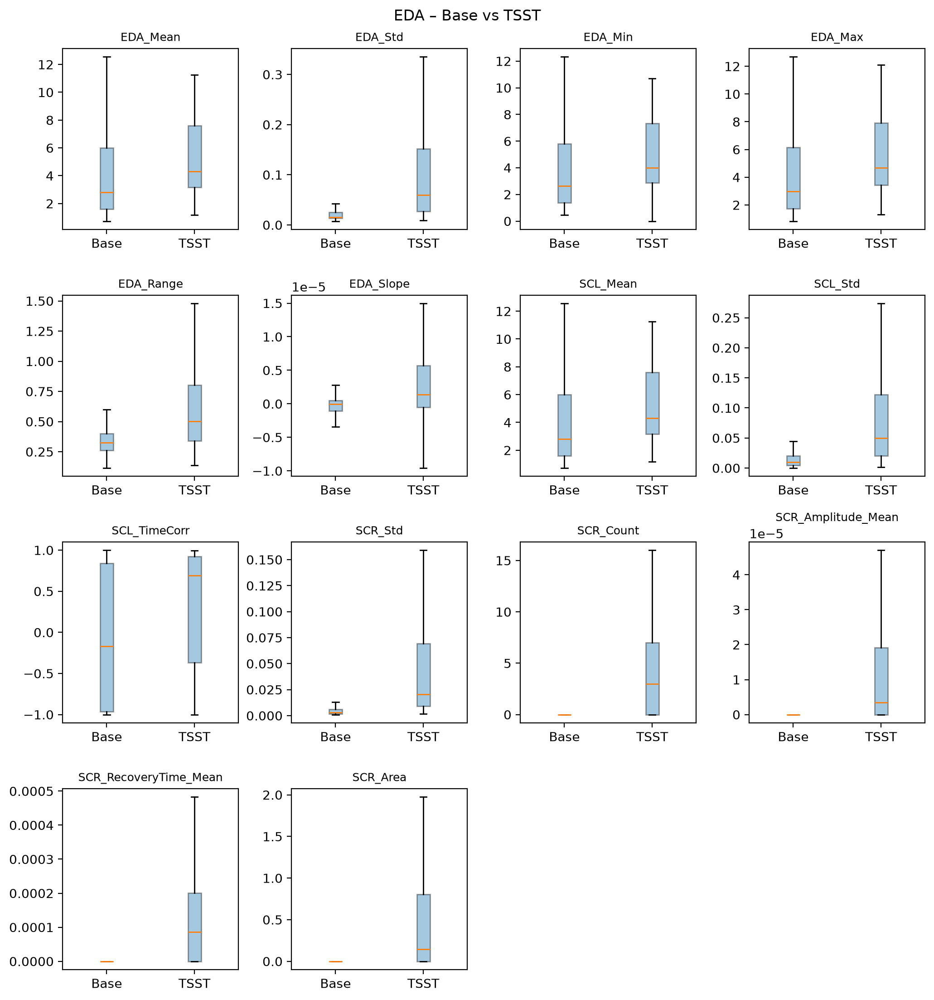 | 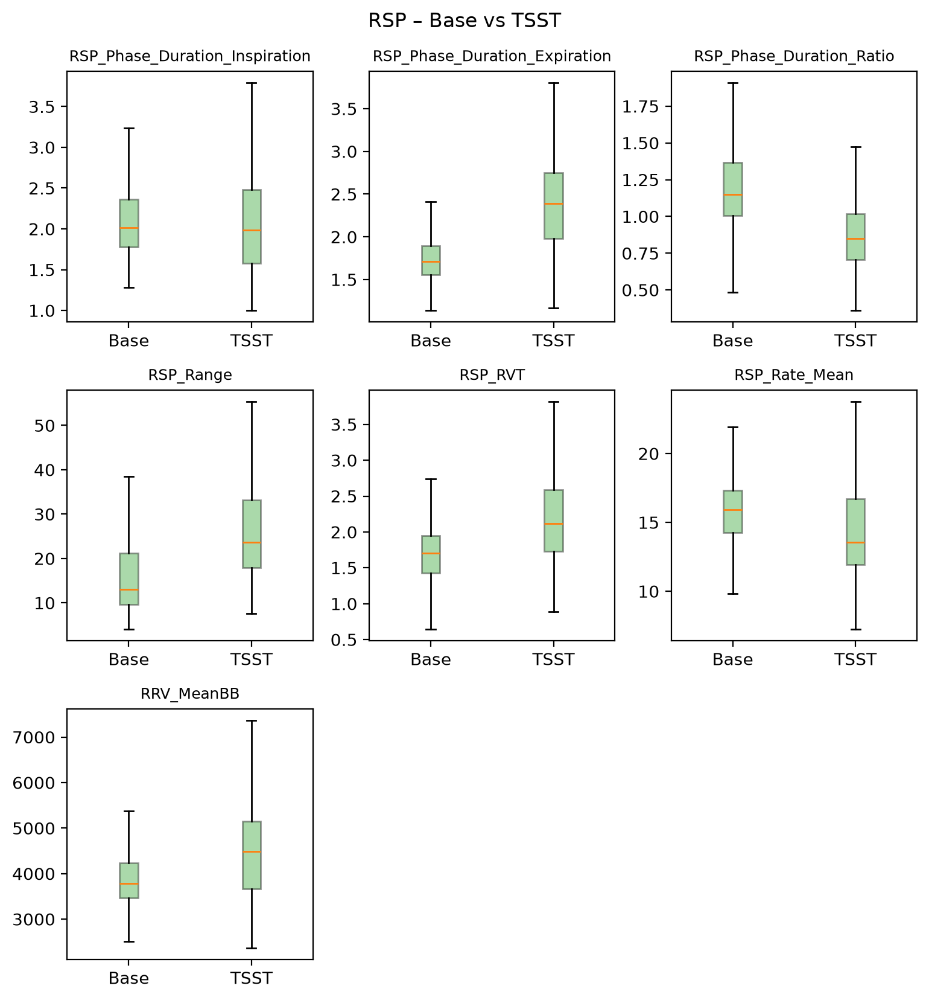 |

**Correlations** (|r| > 0.8): many features are redundant, mostly inside the EDA block.

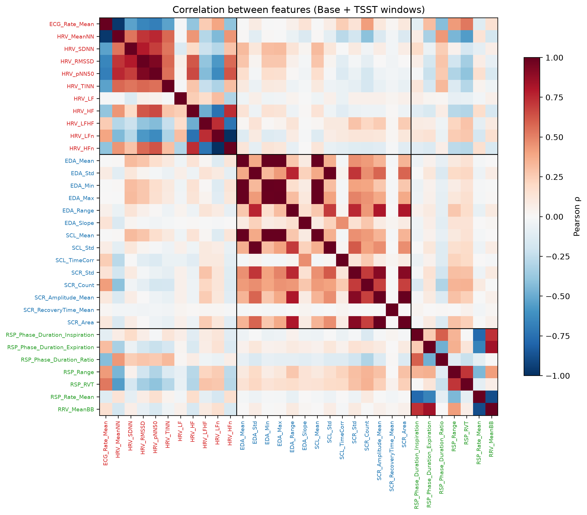

- `EDA_Mean`, `EDA_Min`, `EDA_Max` and `SCL_Mean` are almost identical (r ≈ 0.99–1.0).
- `SCR_Amplitude_Mean` ↔ `SCR_Area` (r = 1.0), `EDA_Std` ↔ `SCL_Std` (0.99).
- `HRV_LFn` ↔ `HRV_HFn` (r = −1.0, they sum to 1).
- `ECG_Rate_Mean` ↔ `HRV_MeanNN` (r = −0.96, heart rate is the inverse of the mean beat interval).

**Hypothesis:** `ECG_Rate_Mean` and `SCR_Count` would be the most discriminative (clear difference in the boxplots, few correlations with other features).

### 2. Preprocessing (given by the template)
- `X` = 32 features only, `y` = 0 for Base, 1 for TSST.
- **Per-subject z-score:** each feature is standardised with the mean and std of the subject's own windows. This removes differences between people (e.g. resting heart rate), but a new person needs some recorded data before the model can be used.
- **Missing values:** windows with at least one NaN are dropped → **2789 windows** (1760 Base, 1029 TSST). Alternative: impute with the subject's median.
- **Imbalance:** `class_weight="balanced"` in the models, and balanced accuracy as the main metric.

### 3. Validation: leave-one-subject-out (LOSO), and no separate test set
Windows overlap by 50 s, and windows of the same person look alike. LOSO trains on 14 subjects and predicts the 15th, 15 times. Each window is predicted by a model that has **never seen its subject**, which measures performance on a new person.

**There is no separate test set in this notebook.** All 2789 windows (15 subjects) go into LOSO, and the same LOSO predictions are used for:
1. choosing the hyper-parameters (`grid_search_loso`),
2. choosing the best model (logistic regression vs random forest),
3. reporting the scores, confusion matrix, per-subject results and importances.

The held-out subject of each fold is therefore both the **validation** and the **test** set. No single final model is trained: each reported score combines the predictions of 15 different models.

- Each prediction is still made on an unseen subject, so the scores do measure generalisation to new people.
- But the same subjects chose the hyper-parameters and the model, so the reported **0.950 is slightly optimistic**.
- The bias is probably small here: all forest settings score 0.941–0.946 and all logistic regression settings 0.942–0.950.

**How to get an unbiased score: nested LOSO.**

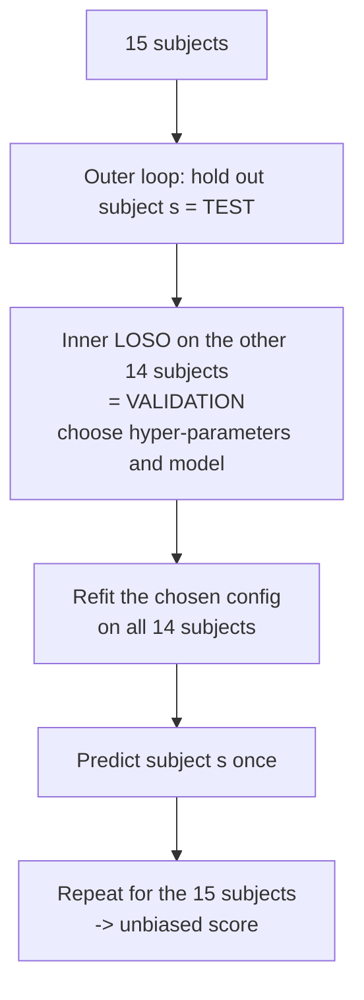

- Alternative: hold out a few subjects (e.g. 3) as a test group from the start, tune with LOSO on the other 12, refit on those 12, and evaluate once. Simpler, but noisier (few test subjects).
- **Final model for deployment:** choose the hyper-parameters with LOSO on all 15 subjects, then retrain on all 15. Its expected performance is the nested-LOSO score.
- The per-subject z-score does not leak: it only uses each subject's own features, never labels or other subjects.

### 4. Models and tuning
`grid_search_loso` scores each hyper-parameter combination with LOSO balanced accuracy.

| Random forest tuning (200 trees) | Logistic regression tuning |
|---|---|
| 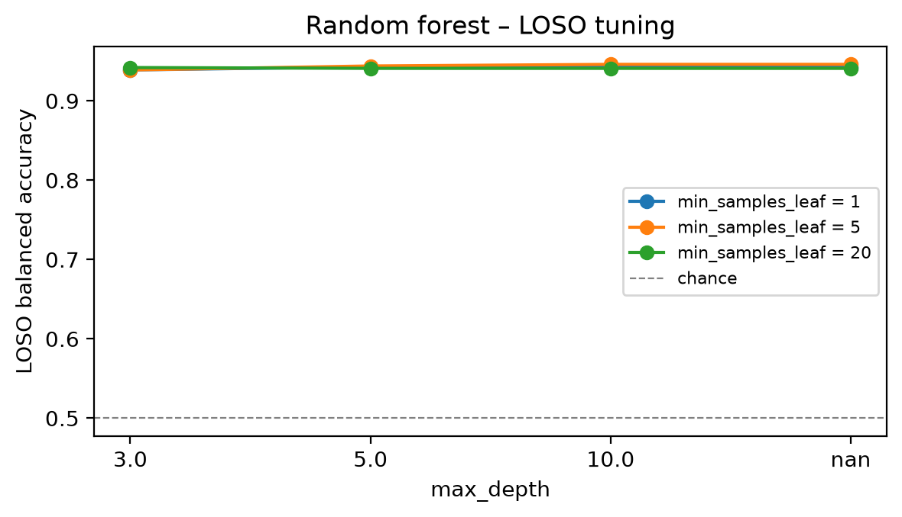 | 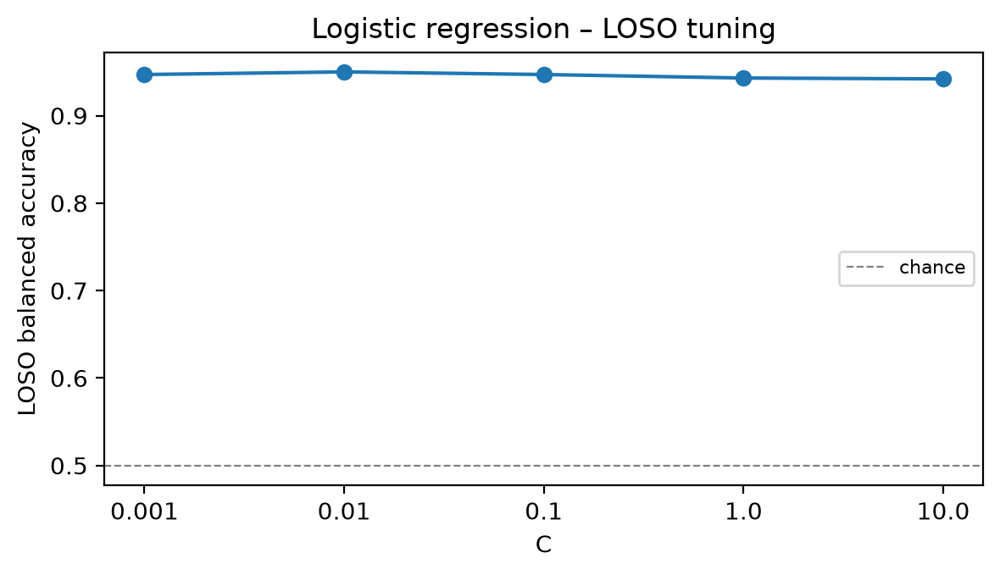 |

- **Random forest:** `max_depth` ∈ {3, 5, 10, None} × `min_samples_leaf` ∈ {1, 5, 20}. Best: **max_depth = 10, min_samples_leaf = 5** (0.946). All combinations are between 0.941 and 0.946, so the forest is not sensitive to these parameters.
- **Logistic regression:** `C` ∈ {0.001, 0.01, 0.1, 1, 10}. Best: **C = 0.01** (0.950), a strong regularisation.
- **Baseline:** always predicts Base.
- Note: hyper-parameters are chosen on the same LOSO scores that are reported, so the scores are slightly optimistic. Nested LOSO would fix this.

### 5. Evaluation

| Model | Accuracy | **Balanced accuracy** | F1 (TSST) | ROC-AUC | Per-subject bal. acc. (mean ± std) |
|---|---|---|---|---|---|
| **Logistic regression (C = 0.01)** | 0.953 | **0.950** | 0.936 | 0.989 | 0.949 ± 0.093 |
| Random forest (tuned) | 0.952 | 0.946 | 0.934 | 0.993 | 0.942 ± 0.120 |
| Random forest (template default) | 0.631 | 0.500 | 0.000 | 0.511 | 0.500 ± 0.000 |
| Baseline (most frequent) | 0.631 | 0.500 | 0.000 | 0.500 | 0.500 ± 0.000 |

- **Balanced accuracy is the main metric:** the baseline already gets 0.63 accuracy without detecting any stress, while its balanced accuracy is 0.5 (chance).

> **What is balanced accuracy?** It is the mean of the **recall of each class**: for each class, the fraction of its true windows that the model got right, then a simple average. Each class counts equally, whatever its size, so chance is always 1/K (0.5 here). For the logistic regression: Base 1690 / 1760 = 0.960, TSST 967 / 1029 = 0.940, so balanced accuracy = (0.960 + 0.940) / 2 = **0.950**. For the "always Base" baseline: (1.0 + 0.0) / 2 = 0.50, while its normal accuracy is 0.63. It is the same as `recall_score(..., average="macro")`. Unlike macro-F1, it ignores precision: it checks that every class is found, not that the predictions of each class are trustworthy.
- The template's default forest (1 tree, depth 1, ≥ 1000 windows per leaf) is no better than the baseline.
- **Logistic regression and the tuned random forest are almost equal** (0.950 vs 0.946). The difference is too small to be meaningful. Logistic regression is kept because it is simpler and more stable across subjects (lower std).

| Confusion matrix (logistic regression) | Per-subject balanced accuracy |
|---|---|
| 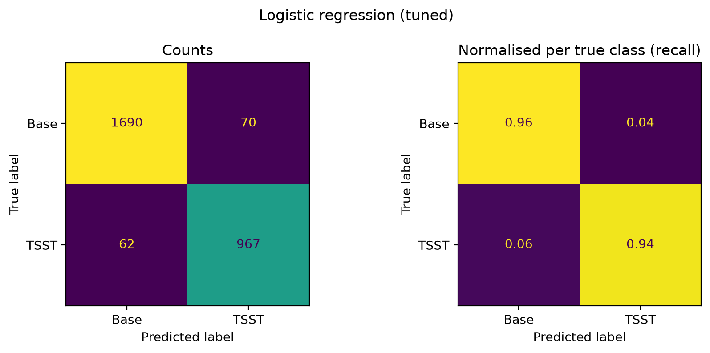 | 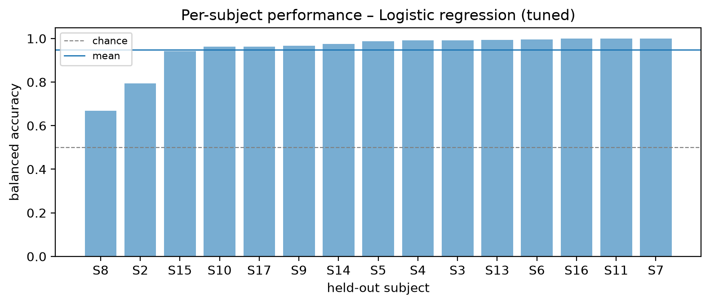 |

- 1690 / 1760 Base and 967 / 1029 TSST windows are correct (recall 0.96 and 0.94).
- Most subjects are above 0.94. Two subjects are clearly worse:
  - **S8: 0.67**, only 45% of its stress windows are detected. S8 is also the subject with missing breathing data.
  - **S2: 0.79**, errors in both directions.

### 6. Interpretation: permutation importance
For each LOSO fold, each feature is shuffled on the held-out subject, and the drop in balanced accuracy is measured.

| Random forest (tuned) | Logistic regression (tuned) |
|---|---|
| 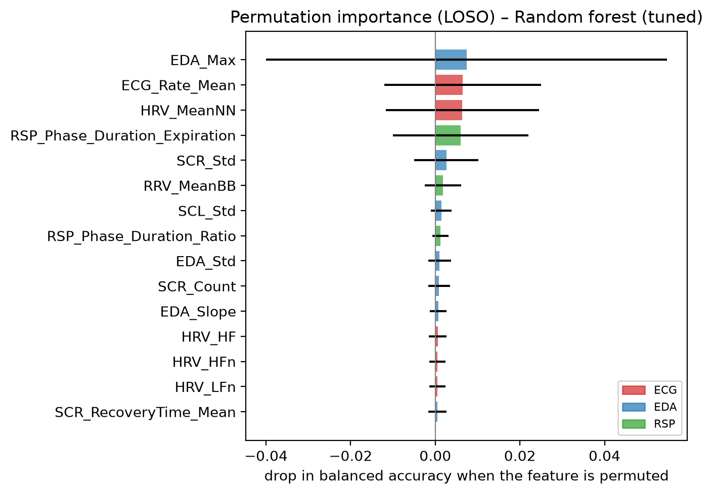 | 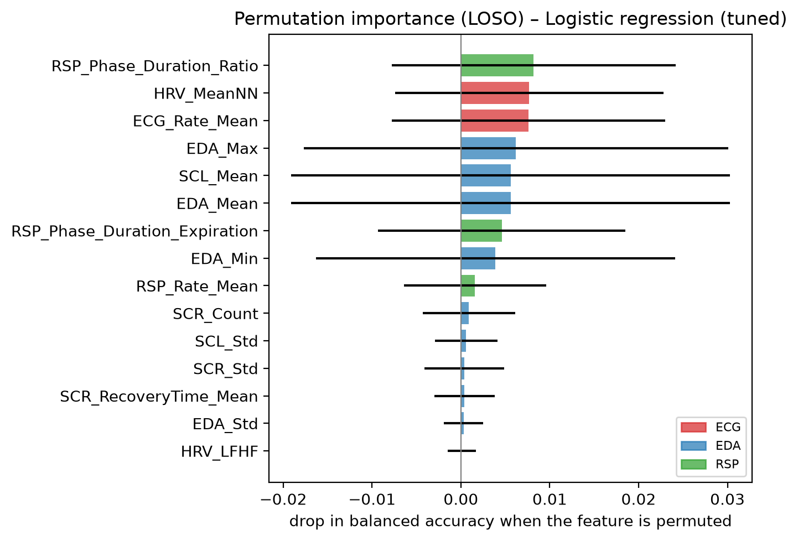 |

| Total importance per modality | Random forest | Logistic regression |
|---|---|---|
| ECG | **0.013** | 0.012 |
| EDA | 0.005 | **0.020** |
| RSP | 0.010 | 0.012 |

- The top features are `EDA_Max`, `ECG_Rate_Mean`, `HRV_MeanNN` and `RSP_Phase_Duration_Expiration` (random forest), and `RSP_Phase_Duration_Ratio`, `HRV_MeanNN`, `ECG_Rate_Mean`, `EDA_Max` (logistic regression).
- **Hypothesis check:** `ECG_Rate_Mean` is in the top 3 of both models (confirmed). `SCR_Count` has almost no importance (not confirmed).
- **Most informative modality:** ECG for the random forest, EDA for logistic regression. All importances are small (≤ 0.01) because many features are redundant: shuffling one feature does little when a correlated copy is still there.
- **Limitations:** the model needs all 32 features and some data from each new person (per-subject normalisation), and was only tested on 15 subjects in a lab protocol.

The optional parts (3 classes with *Fun*, feature selection) are not done.

---

## Part 3: Sleep staging with SleepFM (HMC)

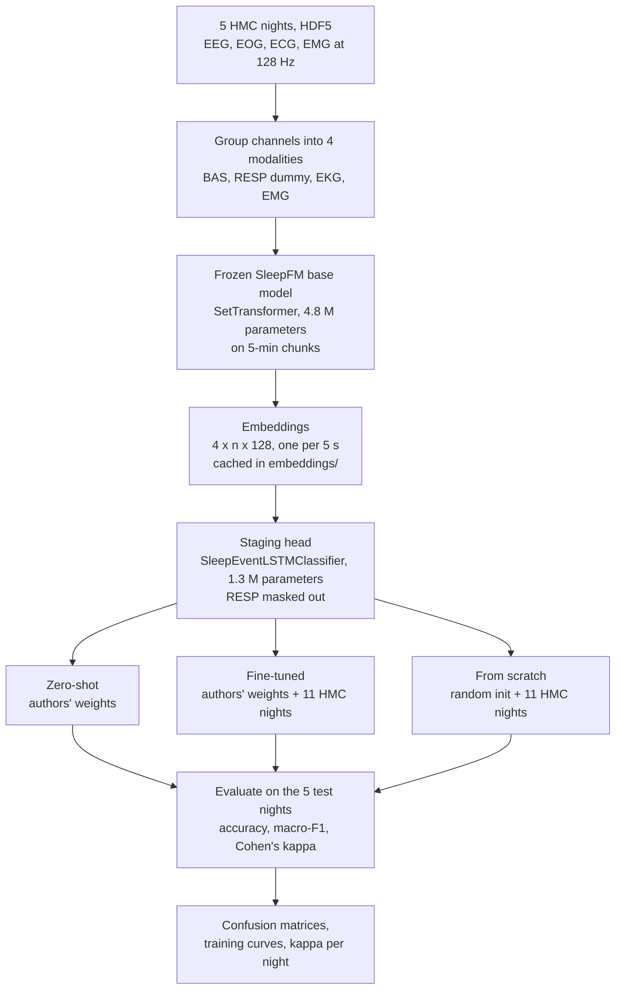

### 1. Data
5 test nights (SN007, SN012, SN013, SN017, SN019), never used to train or select any model. The signals are already resampled to 128 Hz and standardised. Each channel of SN007 has about 3.97 M samples (≈ 8.6 h).

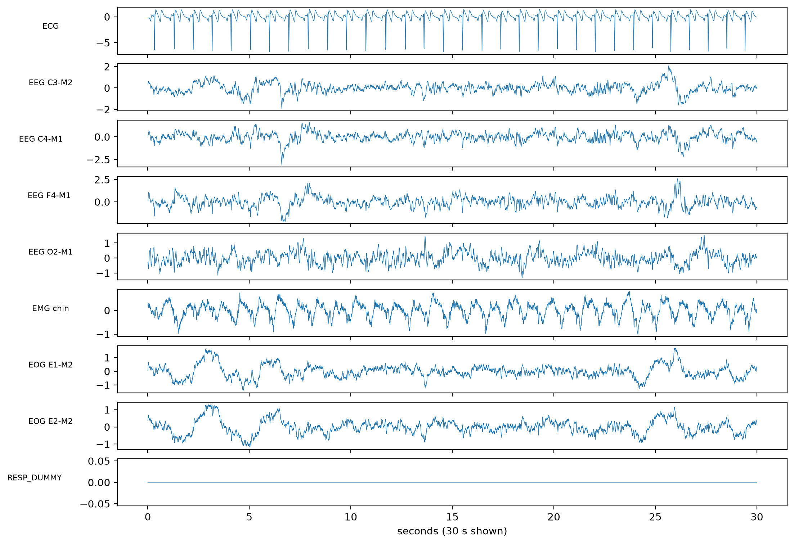

- Labels: one sleep stage per 5 s (each 30 s expert label repeated 6 times).
- Stage proportions vary a lot between nights. For example, Wake is 6% of SN007 but 41% of SN019, and N2 is between 22% and 46%.
- **`RESP_DUMMY` is flat:** HMC has no breathing signal, but SleepFM expects 4 modalities, so a placeholder fills the slot. It is masked out in the staging head.

### Train / validation / test: yes, there is a real test set
The heads were trained beforehand by the instructor. The notebook only evaluates them.

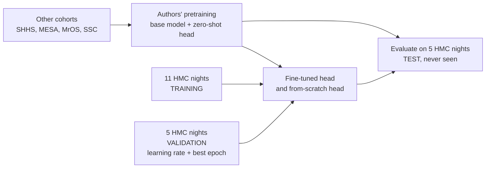

- **Training:** 11 HMC nights, 40 epochs for both heads.
- **Validation:** 5 other HMC nights, used to tune the learning rate and to keep the epoch with the best validation kappa.
- **Test:** the 5 nights of this notebook (SN007, SN012, SN013, SN017, SN019). They were never used to train or select any head, so the scores are unbiased.
- **Limits:** only 5 test nights (kappa varies a lot between nights), all from the same hospital, equipment and scorers as the training nights.

### 2. Embeddings with the base model
The channels are grouped into 4 modalities: **BAS** (4 EEG + 2 EOG), **RESP** (dummy), **EKG** (ECG), **EMG** (chin).
The frozen base model reads 5-minute chunks (38 400 samples) and returns `(pooled_5min, embeddings_5s)`. The notebook keeps **`embeddings_5s`**.

- Shape per night: **(4, n, 128)** = 4 modalities × n windows of 5 s × 128 numbers.
- Example: SN007 → (4, 6180, 128). An 8-hour night gives 8 × 3600 / 5 = 5760 windows.
- `n` is a multiple of 60 because each 5-min chunk gives 60 embeddings and the last incomplete chunk is dropped.
- 5 s embeddings are used rather than 5 min ones because stages change every 30 s: a 5-min vector would mix several stages.

### 3. Staging head (`sleepfm_models.py`)

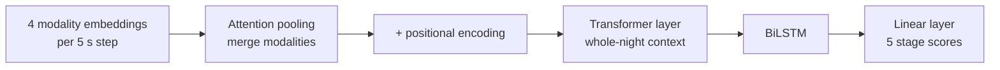

Config: `embed_dim = 128`, 4 heads, 1 layer, 5 classes, dropout 0.3. The predicted stage is `logits[0].argmax(-1)`.
Main metrics: **macro-F1** (every stage counts equally, so the rare N1 weighs as much as N2) and **Cohen's kappa** (agreement with the expert beyond chance).

### 4. Results

| Head | Accuracy | Macro-F1 | **Kappa** |
|---|---|---|---|
| Zero-shot (authors' head) | 0.376 | 0.307 | 0.204 |
| **Fine-tuned (pretrained init)** | **0.737** | **0.705** | **0.660** |
| Trained from scratch (random init) | 0.526 | 0.520 | 0.399 |

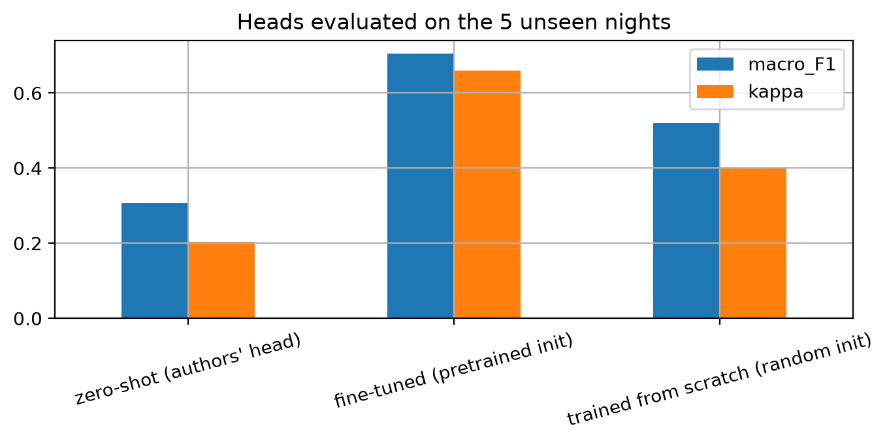

| Zero-shot | Fine-tuned | From scratch |
|---|---|---|
| 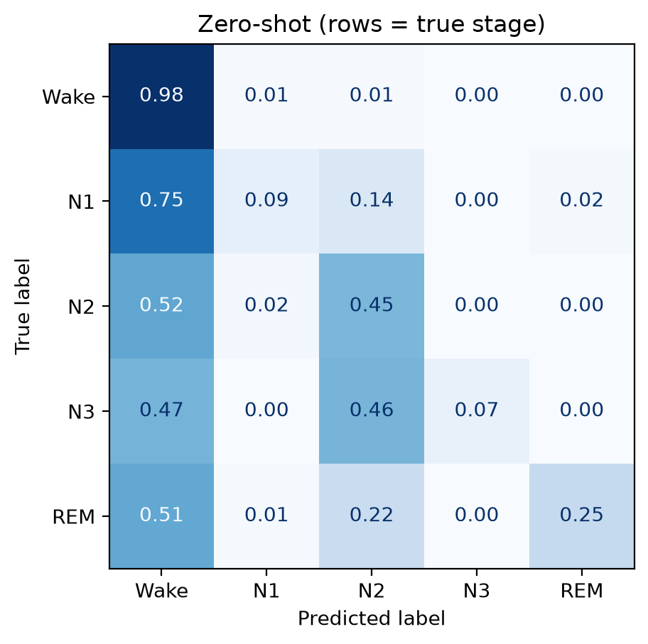 | 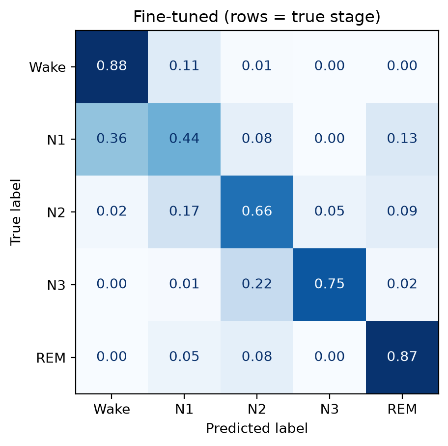 | 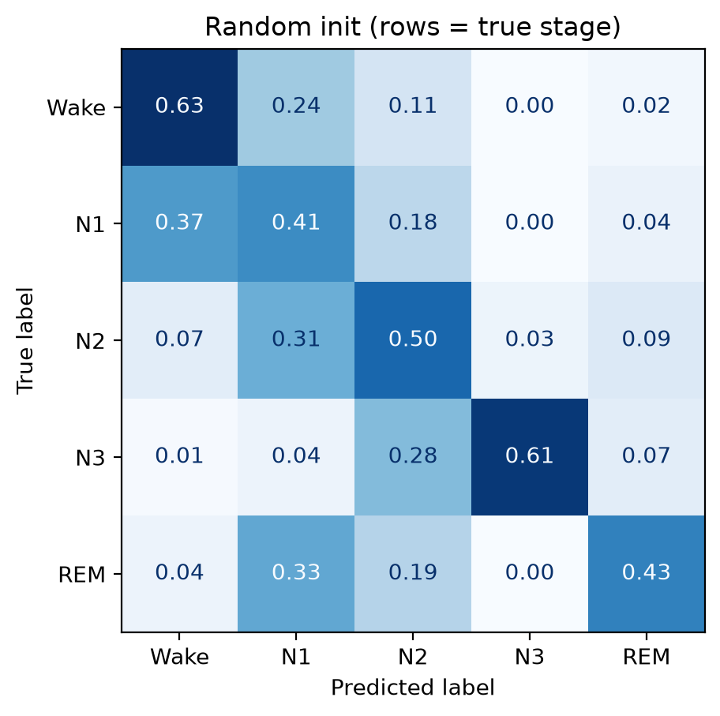 |

- **Zero-shot:** the model predicts **Wake for 60% of the windows** (17 587 predicted vs 4 470 true). About half of the N2, N3 and REM windows are called Wake, and N3 is almost never found (7%). The head was trained on other cohorts (other hospitals, equipment and patients) and with a breathing signal, so it does not transfer to HMC as is.
- **Fine-tuned:** Wake 0.88, REM 0.87, N3 0.75, N2 0.66. **N1 is the hardest stage (0.44)**, often confused with Wake: it is the transition between wake and sleep.
- **From scratch:** same architecture, same 11 nights, same recipe, but kappa 0.40 instead of 0.66.

### Why macro-F1 and not micro or weighted F1?
`evaluate` uses `f1_score(y, p, average="macro")` (TODO 3). The F1 of each of the 5 stages is computed first, then the scores are combined:

| Average | How the 5 per-stage F1 scores are combined | Weight of N1 here |
|---|---|---|
| **macro** | Simple mean: each stage counts 1/5 | 20% |
| **weighted** | Mean weighted by the number of true windows of each stage | ~8% |
| **micro** | Counts all correct/incorrect windows together. With one label per window, this is **the same as accuracy** | (per window, not per stage) |

The true stages of the 5 test nights are very unbalanced:

| Wake | N1 | N2 | N3 | REM |
|---|---|---|---|---|
| 4470 (15%) | 2448 (8%) | 10284 (35%) | 6720 (23%) | 5538 (19%) |

- **Micro-F1 = accuracy**, which is misleading here: a model that is good on N2 and bad on N1 still gets a high score.
- **Weighted-F1** has the same problem: N2 gets 35% of the weight and N1 only 8%, so failing on N1 barely changes the score.
- **Macro-F1** gives N1 the same weight as N2. A model only scores well if it recognises **every** stage, which is what matters clinically: N1 (falling asleep), N3 (deep sleep) and REM are what reveal sleep disorders.

**In our results:** with the fine-tuned head, N1 is the weak stage (recall 0.44, F1 ≈ 0.35 estimated from the confusion matrix), while the other stages are around 0.7–0.8.

| Fine-tuned head | Score |
|---|---|
| Micro-F1 (= accuracy) | 0.737 |
| Weighted-F1 (estimated from the confusion matrix) | ≈ 0.74 |
| **Macro-F1** | **0.705** |

Macro is the lowest because the large N2/N3/REM classes can't hide the poor N1 performance. The same happens with zero-shot: accuracy 0.376 but macro-F1 only 0.307, because N1 and N3 are almost never found (recall 0.09 and 0.07).

**About our notebook answer (Question 3):** *"Because we want each sleep stage to matter as much as the other ones, solving our unbalanced issue."* The idea is right, but macro-F1 **does not solve** the imbalance: the data and the model are unchanged. It only makes the **metric** fair to the rare stages, so the imbalance can't hide bad performance on them. A more precise answer:

> Macro-F1 averages the F1 of the 5 stages with equal weight, so rare stages (N1 ~8%, Wake ~15%) count as much as N2 (~35%). Micro-F1 equals accuracy and weighted-F1 is dominated by the frequent stages, so both would hide a model that fails on N1 or N3. Macro-F1 doesn't fix the imbalance in the data: it makes the evaluation sensitive to every stage, which matters clinically since rare stages like N1, N3 and REM are the ones that reveal sleep disorders.

> **What is Cohen's kappa?** It measures agreement between the model and the expert **beyond what chance would give**: κ = (p_o − p_e) / (1 − p_e). Here p_o is the observed agreement (= accuracy) and p_e is the agreement expected by chance if the predictions were random with the same stage proportions: p_e = Σ_k (share of true stage k) × (share of predicted stage k). κ = 0 means no better than chance, κ = 1 is perfect agreement, and κ < 0 is worse than chance. The usual reading: 0.4–0.6 moderate, 0.6–0.8 substantial, > 0.8 almost perfect. For zero-shot: p_o = 0.376 and p_e ≈ 0.216 (mostly because both the truth and the predictions contain a lot of N2 and Wake), so κ = (0.376 − 0.216) / (1 − 0.216) ≈ **0.204**. Kappa is useful here because accuracy can look decent just by predicting the frequent stages, while kappa removes that "free" agreement. It is also the standard metric for agreement between human sleep scorers, so the model can be compared to them. It was used to pick the best epoch during training and to compare the nights.

### 5. Training history

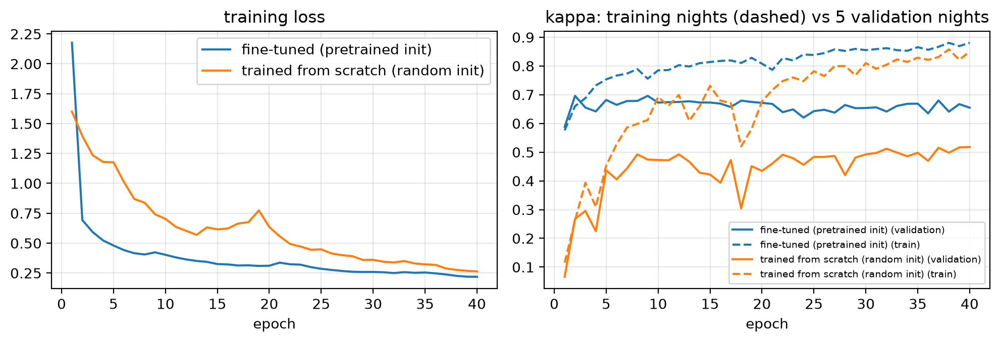

- The fine-tuned head starts with a much lower loss and reaches a validation kappa of about 0.68 after 2 epochs, then stays flat.
- The scratch head learns slowly and is unstable. Its training kappa catches up (0.85) but its validation kappa stays around 0.5: it overfits the 11 training nights.
- Since only the initialisation differs, the gap comes from what the pretrained head already knows: how to read SleepFM embeddings and how a night is structured (stage transitions, sleep cycles).
- The experiment says nothing about the base model itself: all three heads use the same SleepFM embeddings, so we can't compare with a model trained on raw signals.

### 6. Kappa per night

| Night | Zero-shot | Fine-tuned | From scratch |
|---|---|---|---|
| SN007 | 0.53 | 0.66 | 0.29 |
| SN012 | 0.00 | 0.74 | 0.70 |
| SN013 | −0.01 | 0.66 | 0.27 |
| SN017 | 0.08 | 0.52 | 0.36 |
| SN019 | 0.53 | 0.69 | 0.43 |

- Scores vary a lot between nights, so a single global number hides large differences. With only 5 nights, one night more or less changes the result noticeably.
- The fine-tuned head is the best on every night, so the ranking of the models is reliable even if the exact values are not.
- Remaining weakness: all nights come from the same hospital, equipment and scorers. Performance in another hospital is unknown.

**Conclusion:** pretraining brings about **+0.26 kappa** for the same labelled data and compute. Zero-shot is free but doesn't work here. The expensive part (pretraining on large cohorts) was done once by the authors and is reused for free.

---

## Things to fix before handing in

**Part 1**
- The windowing answer says "overlap of 0.5 seconds… 10%". `overlap = 0.5` means 50% (2.5 s).
- `recordings.copy()` only copies the dict, so the in-place `drop` also trims the original `recordings`.
- Leftover markdown cell "Remove the first and last".
- The KNN answer doesn't cover the "methodological problem / how to fix it" part.

**Part 2**
- Bug: `(df_bin['subject'] == 8)` compares to an int, but subjects are strings like `"S8"`, so the total is shown as "out of 0 total".
- "Which groups of features are redundant?" is unanswered (the list above could be used).
- The hypothesis names `SCR_Count`, but the discussion in 5.2 refers to `RSP_Rate_Mean`.
- The optimistic-score answer doesn't say how to prevent it (nested LOSO).
- Section 6 (Fun class) and the feature-selection bonus are still `TODO`.

**Part 3**
- Q1 is missing the 8-hour count (5760) and why `n` is a multiple of 60.
- Q0 could say more plainly that HMC has no breathing signal, so a flat placeholder fills the slot and the model masks it out.
- Q3 says macro-F1 is "solving our unbalanced issue". It doesn't change the imbalance, it only makes the metric fair to rare stages (see "Why macro-F1" above).
